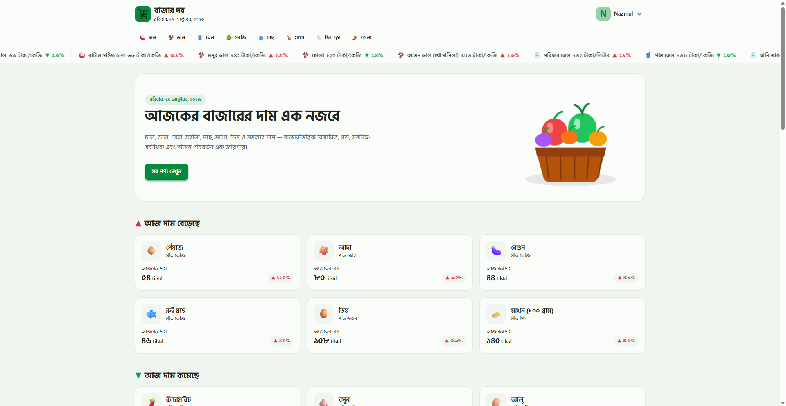
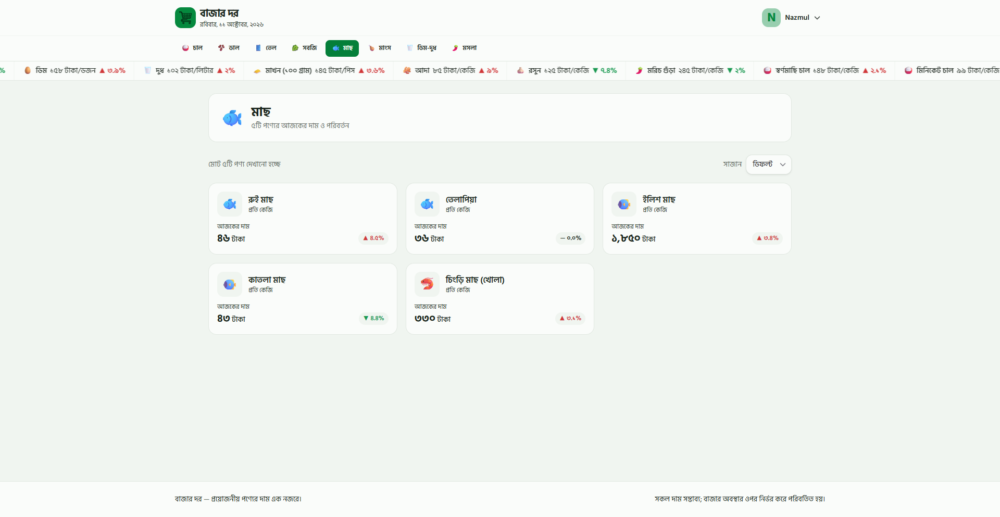
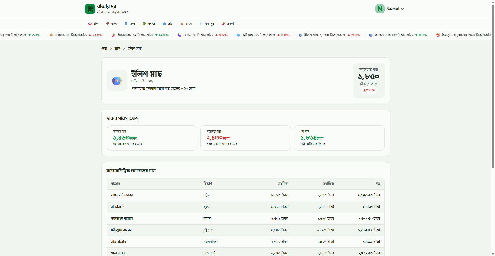
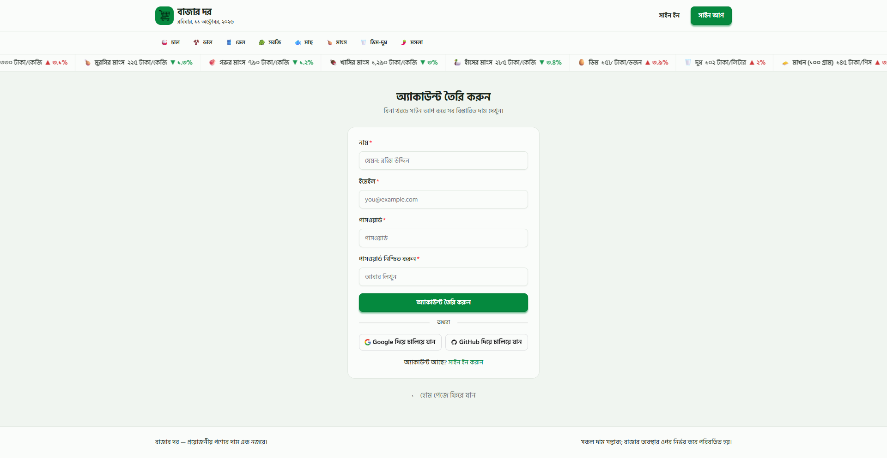

# 🛒 বাজার দর (Bazar Dor)

### বাংলাদেশের নিত্যপ্রয়োজনীয় পণ্যের দাম জানুন, বাজার বুঝুন, সচেতনভাবে কেনাকাটা করুন।

**বাজার দর** একটি আধুনিক ওয়েব অ্যাপ্লিকেশন, যার মাধ্যমে চাল, ডাল, তেল, শাকসবজি, মাছ, মাংস, ডিম ও মসলাসহ নিত্যপ্রয়োজনীয় পণ্যের বাজারদর সহজে দেখা যায়। পণ্যের বর্তমান দাম, বাজারভিত্তিক মূল্যতথ্য এবং দামের ওঠানামা এক জায়গায় উপস্থাপন করাই এই প্রজেক্টের মূল লক্ষ্য।

🔗 **লাইভ প্রজেক্ট:** [Bazar Dor](https://bd-bazar-dor.vercel.app/)

📂 **GitHub Repository:** [NazmulHossain2905/BazarDor](https://github.com/NazmulHossain2905/BazarDor)

---

## 📑 সূচিপত্র

- [প্রজেক্ট পরিচিতি](#-প্রজেক্ট-পরিচিতি)
- [প্রধান বৈশিষ্ট্যসমূহ](#-প্রধান-বৈশিষ্ট্যসমূহ)
- [প্রজেক্টের স্ক্রিনশট](#-প্রজেক্টের-স্ক্রিনশট)
- [ব্যবহৃত প্রযুক্তি](#-ব্যবহৃত-প্রযুক্তি)
- [প্রজেক্ট স্ট্রাকচার](#-প্রজেক্ট-স্ট্রাকচার)
- [API ও ডেটা](#-api-ও-ডেটা)
- [লোকালি চালানোর নিয়ম](#-প্রজেক্টটি-লোকালি-চালানোর-নিয়ম)
- [Environment Variables](#-environment-variables)
- [বিল্ড ও ডিপ্লয়মেন্ট](#-বিল্ড-ও-ডিপ্লয়মেন্ট)
- [প্রজেক্টের লিংক](#-প্রজেক্টের-লিংক)
- [ডেভেলপার](#-ডেভেলপার)
- [প্রয়োজনীয় লিংকসমূহ](#-প্রয়োজনীয়-লিংকসমূহ)
- [কৃতজ্ঞতা](#-কৃতজ্ঞতা)

## 📌 প্রজেক্ট পরিচিতি

দৈনন্দিন বাজার করার আগে কোনো পণ্যের দাম বেড়েছে নাকি কমেছে, তা জানা বেশ গুরুত্বপূর্ণ। বাজার দর সেই তথ্য সহজে খুঁজে পেতে সাহায্য করার জন্য তৈরি করা হয়েছে।

অ্যাপ্লিকেশনটিতে পণ্যের তালিকা, ক্যাটাগরিভিত্তিক পণ্য, মূল্য পরিবর্তনের তথ্য এবং নির্দিষ্ট পণ্যের বিস্তারিত দেখার সুবিধা রয়েছে। পাশাপাশি ব্যবহারকারীরা অ্যাকাউন্ট তৈরি করে সাইন ইন করতে পারবেন এবং সুরক্ষিত পেজগুলোতে প্রবেশ করতে পারবেন।

## ✨ প্রধান বৈশিষ্ট্যসমূহ

- 🏠 **পণ্যের তালিকা:** নিত্যপ্রয়োজনীয় পণ্যের বাজারদর এক জায়গায় দেখুন।
- 📊 **দামের পরিবর্তন:** যেসব পণ্যের দাম বেড়েছে বা কমেছে, সেগুলো আলাদাভাবে দেখুন।
- 🗂️ **ক্যাটাগরিভিত্তিক ব্রাউজিং:** নির্দিষ্ট ক্যাটাগরির পণ্য ও তাদের দাম খুঁজুন।
- 🔎 **পণ্যের বিস্তারিত:** একটি নির্দিষ্ট পণ্যের মূল্যসংক্রান্ত তথ্য দেখুন।
- 🔐 **নিরাপদ অথেনটিকেশন:** ইমেইল ও পাসওয়ার্ডের মাধ্যমে অ্যাকাউন্ট তৈরি এবং সাইন ইন করুন।
- 🌐 **Google ও GitHub সাইন ইন:** সমর্থিত সোশ্যাল প্রোভাইডারের মাধ্যমে লগইন করুন।
- 👤 **প্রোফাইল ও সুরক্ষিত পেজ:** লগইন করা ব্যবহারকারীদের জন্য নির্দিষ্ট পেজে প্রবেশের ব্যবস্থা।
- 📱 **রেসপনসিভ ডিজাইন:** বিভিন্ন স্ক্রিনের উপযোগী ইন্টারফেস তৈরির জন্য আধুনিক স্টাইলিং প্রযুক্তি ব্যবহার করা হয়েছে।

## 🖼️ প্রজেক্টের স্ক্রিনশট

<table>
  <tr>
    <td align="center">
      <strong>হোমপেজ</strong><br />
      
    </td>
    <td align="center">
      <strong>ক্যাটাগরি পেজ</strong><br />
      
    </td>
  </tr>
  <tr>
    <td align="center">
      <strong>পণ্যের বিস্তারিত</strong><br />
      
    </td>
    <td align="center">
      <strong>লগইন ও অথেনটিকেশন</strong><br />
      
    </td>
  </tr>
</table>

## 🧰 ব্যবহৃত প্রযুক্তি

| প্রযুক্তি                                                              | ব্যবহার                           |
| ---------------------------------------------------------------------- | --------------------------------- |
| [Next.js](https://nextjs.org/)                                         | ওয়েব অ্যাপ্লিকেশন ও রাউটিং       |
| [React](https://react.dev/)                                            | ইউজার ইন্টারফেস তৈরি              |
| [TypeScript](https://www.typescriptlang.org/)                          | টাইপ-সেফ কোড লেখা                 |
| [Tailwind CSS](https://tailwindcss.com/)                               | স্টাইলিং ও রেসপনসিভ ডিজাইন        |
| [HeroUI](https://www.heroui.com/)                                      | UI কম্পোনেন্ট                     |
| [Better Auth](https://www.better-auth.com/)                            | অথেনটিকেশন ও সেশন ব্যবস্থাপনা     |
| [MongoDB](https://www.mongodb.com/)                                    | অথেনটিকেশন-সংক্রান্ত ডেটা সংরক্ষণ |
| [Iconify](https://iconify.design/)                                     | আইকন                              |
| [React Icons](https://react-icons.github.io/react-icons/)              | আইকন কম্পোনেন্ট                   |
| [React Fast Marquee](https://www.npmjs.com/package/react-fast-marquee) | চলমান কনটেন্ট বা মারকুই           |

## 📁 প্রজেক্ট স্ট্রাকচার

```txt
BazarDor/
├── public/                             # স্ট্যাটিক ফাইল ও স্ক্রিনশট রাখার ডিরেক্টরি
│   └── screenshots/                    # README-তে দেখানোর স্ক্রিনশট
│       ├── home.png                    # হোমপেজের স্ক্রিনশট
│       ├── category.png                # ক্যাটাগরি পেজের স্ক্রিনশট
│       ├── product-details.png         # পণ্যের বিস্তারিত পেজের স্ক্রিনশট
│       └── authentication.png          # লগইন বা সাইন-আপ পেজের স্ক্রিনশট
│
├── src/
│   ├── proxy.ts                        # রিকোয়েস্ট প্রক্সি ও নির্ধারিত অ্যাক্সেস নিয়ন্ত্রণ
│   │
│   ├── apis/
│   │   └── product.ts                  # পণ্যের API-সংক্রান্ত ফাংশন ও ডেটা সংগ্রহ
│   │
│   ├── app/                            # Next.js App Router ও অ্যাপের পেজসমূহ
│   │   ├── globals.css                 # গ্লোবাল CSS ও অ্যাপের সামগ্রিক স্টাইল
│   │   ├── icon.png                    # ব্রাউজার ওয়েবসাইট আইকন
│   │   ├── layout.tsx                  # মূল লেআউট, metadata ও shared UI
│   │   ├── loading.tsx                 # অ্যাপের সাধারণ লোডিং UI
│   │   ├── not-found.tsx               # পেজ না পাওয়া গেলে 404 UI
│   │   ├── page.tsx                    # ওয়েবসাইটের হোমপেজ
│   │   │
│   │   ├── (account)/                  # অ্যাকাউন্ট-সংক্রান্ত রুট গ্রুপ
│   │   │   └── profile/
│   │   │       └── page.tsx            # ব্যবহারকারীর প্রোফাইল পেজ
│   │   │
│   │   ├── (auth)/                     # অথেনটিকেশন পেজের রুট গ্রুপ
│   │   │   ├── signin/
│   │   │   │   └── page.tsx            # ব্যবহারকারীর সাইন-ইন পেজ
│   │   │   └── signup/
│   │   │       └── page.tsx            # নতুন অ্যাকাউন্ট তৈরির পেজ
│   │   │
│   │   ├── api/
│   │   │   └── auth/
│   │   │       └── [...all]/
│   │   │           └── route.ts        # Better Auth-এর API রুট হ্যান্ডলার
│   │   │
│   │   ├── category/
│   │   │   └── [slug]/
│   │   │       ├── loading.tsx         # ক্যাটাগরি পেজের লোডিং UI
│   │   │       └── page.tsx            # নির্দিষ্ট ক্যাটাগরির পণ্য দেখানো
│   │   │
│   │   └── product/
│   │       └── [id]/
│   │           ├── loading.tsx         # পণ্যের বিস্তারিত পেজের লোডিং UI
│   │           └── page.tsx            # নির্দিষ্ট পণ্যের বিস্তারিত পেজ
│   │
│   ├── assets/
│   │   └── images/                     # অ্যাপে ব্যবহৃত ইমেজ অ্যাসেট
│   │       ├── bazar-hero.png          # হোমপেজের হিরো সেকশনের ছবি
│   │       └── logo-icon.png           # অ্যাপের লোগো আইকন
│   │
│   ├── components/                     # পুনর্ব্যবহারযোগ্য UI কম্পোনেন্ট
│   │   ├── Footer.tsx                  # ওয়েবসাইটের ফুটার
│   │   ├── MarketTable.tsx             # বাজারদরের তথ্য টেবিলে দেখানো
│   │   │
│   │   ├── category/                   # ক্যাটাগরির UI কম্পোনেন্ট
│   │   │   ├── ProductsList.tsx        # ক্যাটাগরির পণ্যের তালিকা
│   │   │   └── SortDropDown.tsx        # পণ্যের তালিকা সাজানোর ড্রপডাউন
│   │   │
│   │   ├── common/                     # একাধিক পেজে ব্যবহৃত সাধারণ কম্পোনেন্ট
│   │   │   ├── AppMarquee.tsx          # চলমান কনটেন্ট বা মারকুই
│   │   │   ├── Button.tsx              # পুনর্ব্যবহারযোগ্য বাটন
│   │   │   ├── CurrentBanglaDate.tsx   # বর্তমান বাংলা তারিখ দেখানো
│   │   │   ├── Input.tsx               # পুনর্ব্যবহারযোগ্য ইনপুট ফিল্ড
│   │   │   ├── ProductCard.tsx         # একটি পণ্যের তথ্যের কার্ড
│   │   │   ├── ProductsGrid.tsx        # গ্রিড আকারে পণ্য দেখানো
│   │   │   ├── SocialButtons.tsx       # সোশ্যাল সাইন-ইনের বাটন
│   │   │   └──
│   │   │
│   │   ├── header/                     # হেডার ও নেভিগেশন কম্পোনেন্ট
│   │   │   ├── Authentication.tsx      # অথেনটিকেশন-সংক্রান্ত হেডার UI
│   │   │   ├── CategoryNavLinks.tsx    # ক্যাটাগরির নেভিগেশন লিংক
│   │   │   ├── CategoryNavSkeleton.tsx # নেভিগেশন লোডিং স্কেলেটন
│   │   │   ├── index.tsx               # হেডারের মূল কম্পোনেন্ট
│   │   │   ├── Logo.tsx                # ব্র্যান্ড লোগো
│   │   │   ├── NavCategory.tsx         # ক্যাটাগরি নেভিগেশন
│   │   │   ├── RightContent.tsx        # হেডারের ডান পাশের কনটেন্ট
│   │   │   ├── User.tsx                # ব্যবহারকারী-সংক্রান্ত হেডার UI
│   │   │   └── UserMenu.tsx            # ব্যবহারকারীর মেনু
│   │   │
│   │   ├── home/                       # হোমপেজের নির্দিষ্ট কম্পোনেন্ট
│   │   │   ├── AllProducts.tsx         # সব পণ্যের তালিকা
│   │   │   ├── Hero.tsx                # হোমপেজের প্রধান পরিচিতি সেকশন
│   │   │   ├── PriceDecreased.tsx      # দাম কমেছে এমন পণ্যের অংশ
│   │   │   └── PriceIncreased.tsx      # দাম বেড়েছে এমন পণ্যের অংশ
│   │   │
│   │   ├── price-ticker-marquee/       # চলমান বাজারদরের UI
│   │   │   ├── index.tsx               # প্রাইস টিকার মারকুইয়ের মূল কম্পোনেন্ট
│   │   │   ├── PriceTickerItem.tsx     # টিকারে একটি পণ্যের মূল্য
│   │   │   └── PriceTickerSkeleton.tsx # টিকার লোডিং স্কেলেটন
│   │   │
│   │   ├── product-details/            # পণ্যের বিস্তারিত পেজের কম্পোনেন্ট
│   │   │   ├── Breadcrumb.tsx          # পেজের অবস্থান নির্দেশক নেভিগেশন
│   │   │   ├── PriceSummary.tsx        # পণ্যের মূল্যসংক্রান্ত সারাংশ
│   │   │   └── ProductOverview.tsx     # পণ্যের সামগ্রিক তথ্য
│   │   │
│   │   └── profile/                    # প্রোফাইল পেজের কম্পোনেন্ট
│   │       ├── ProfileCard.tsx         # ব্যবহারকারীর প্রোফাইল কার্ড
│   │       ├── ProfileLoading.tsx      # প্রোফাইল লোডিং UI
│   │       └── ProfilePage.tsx         # প্রোফাইল পেজের মূল UI
│   │
│   ├── interfaces/                     # TypeScript ডেটা ইন্টারফেস
│   │   ├── ICategory.ts                # ক্যাটাগরির ডেটা স্ট্রাকচার
│   │   ├── IProduct.ts                 # পণ্যের ডেটা স্ট্রাকচার
│   │   └── IUser.tsx                   # ব্যবহারকারীর ডেটা স্ট্রাকচার
│   │
│   ├── lib/                            # অথেনটিকেশন ও সার্ভিস কনফিগারেশন
│   │   ├── auth-client.ts              # ক্লায়েন্ট-সাইড Better Auth সেটআপ
│   │   └── auth.ts                     # সার্ভার-সাইড Better Auth সেটআপ
│   │
│   └── utils/                          # পুনর্ব্যবহারযোগ্য ইউটিলিটি ফাংশন
│       ├── bengaliDigit.ts             # ইংরেজি সংখ্যা থেকে বাংলা সংখ্যা
│       └── getUnitInBangla.ts          # এককের বাংলা নাম বা রূপান্তর
│
├── .gitignore                          # Git-এ বাদ দেওয়া ফাইল ও ফোল্ডার
├── README.md                           # প্রজেক্টের ডকুমেন্টেশন
├── eslint.config.mjs                   # ESLint কনফিগারেশন
├── next.config.ts                      # Next.js কনফিগারেশন
├── package.json                        # ডিপেন্ডেন্সি ও npm স্ক্রিপ্ট
├── package-lock.json                   # নির্দিষ্ট ডিপেন্ডেন্সি সংস্করণের লকফাইল
└── tsconfig.json                       # TypeScript কনফিগারেশন
```

## ⚙️ প্রজেক্টটি লোকালি চালানোর নিয়ম

প্রজেক্টটি নিজের কম্পিউটারে চালানোর জন্য নিচের ধাপগুলো অনুসরণ করুন।

### ১. প্রয়োজনীয় সফটওয়্যার

- Node.js
- npm
- Git
- MongoDB ডেটাবেস বা MongoDB Atlas অ্যাকাউন্ট

### ২. রিপোজিটরি ক্লোন করুন

```bash
git clone https://github.com/NazmulHossain2905/BazarDor.git
```

### ৩. প্রজেক্ট ডিরেক্টরিতে প্রবেশ করুন

```bash
cd BazarDor
```

### ৪. ডিপেন্ডেন্সি ইনস্টল করুন

```bash
npm install
```

### ৫. Environment Variables সেট করুন

প্রজেক্টের রুট ডিরেক্টরিতে `.env` নামে একটি ফাইল তৈরি করুন।

```env
DATABASE_URL=your_mongodb_connection_string

BETTER_AUTH_SECRET=your_secure_random_secret
BETTER_AUTH_URL=http://localhost:3000

GOOGLE_CLIENT_ID=your_google_client_id
GOOGLE_CLIENT_SECRET=your_google_client_secret

GITHUB_CLIENT_ID=your_github_client_id
GITHUB_CLIENT_SECRET=your_github_client_secret
```

**গুরুত্বপূর্ণ:**

- `DATABASE_URL`-এ আপনার MongoDB connection string দিন।
- `BETTER_AUTH_SECRET`-এ একটি শক্তিশালী, গোপন secret ব্যবহার করুন।
- Google ও GitHub OAuth ব্যবহার করতে চাইলে সংশ্লিষ্ট প্রোভাইডারগুলোর credentials সংগ্রহ করুন।
- শুধুমাত্র ইমেইল ও পাসওয়ার্ডের মাধ্যমে অথেনটিকেশন পরীক্ষা করলে সোশ্যাল লগইনের credentials প্রয়োজন হবে না।
- `.env` ফাইল কখনো GitHub-এ প্রকাশ করবেন না।

### ৬. ডেভেলপমেন্ট সার্ভার চালু করুন

```bash
npm run dev
```

ব্রাউজারে নিচের ঠিকানাটি খুলুন:

```text
http://localhost:3000
```

## 🔐 OAuth সেটআপ

Google ও GitHub OAuth দিয়ে লগইন করার জন্য সংশ্লিষ্ট Developer Console-এ সঠিক URL কনফিগার করতে হবে। Redirect URL ভুল হলে `redirect_uri_mismatch`-এর মতো error দেখা দিতে পারে।

**লাইভ URL:** `https://bd-bazar-dor.vercel.app`

### Google OAuth

[Google Cloud Console](https://console.cloud.google.com/) → **APIs & Services → Credentials** থেকে OAuth 2.0 Client ID তৈরি বা কনফিগার করো।

| Field                                 | মান                                                           |
| ------------------------------------- | ------------------------------------------------------------- |
| Authorized JavaScript origins         | `http://localhost:3000` এবং `https://bd-bazar-dor.vercel.app` |
| Authorized redirect URIs (Local)      | `http://localhost:3000/api/auth/callback/google`              |
| Authorized redirect URIs (Production) | `https://bd-bazar-dor.vercel.app/api/auth/callback/google`    |

### GitHub OAuth

[GitHub Developer Settings](https://github.com/settings/developers) → **OAuth Apps** থেকে OAuth App তৈরি বা কনফিগার করো।

| Field                                   | মান                                                        |
| --------------------------------------- | ---------------------------------------------------------- |
| Homepage URL                            | `https://bd-bazar-dor.vercel.app`                          |
| Authorization callback URL (Production) | `https://bd-bazar-dor.vercel.app/api/auth/callback/github` |

> **লোকাল ডেভেলপমেন্ট:** GitHub OAuth App-এ একটি callback URL কনফিগার করা যায়। লোকাল ও প্রোডাকশন পরিবেশে আলাদা callback URL ব্যবহার করতে চাইলে পৃথক Development ও Production OAuth App তৈরি করো।

## 🔌 API ও ডেটা

পণ্যের তথ্য এবং ক্যাটাগরির ডেটা Programming Hero-এর BazarDor API থেকে সংগ্রহ করা হয়।

**Base URL:**

```text
https://openapi.programming-hero.com/api/bazardor
```

| Endpoint                  | কাজ                        |
| ------------------------- | -------------------------- |
| `/products`               | সব পণ্যের তথ্য             |
| `/products?category=chal` | নির্দিষ্ট ক্যাটাগরির পণ্য  |
| `/products/{productId}`   | একটি নির্দিষ্ট পণ্যের তথ্য |
| `/categories`             | সব ক্যাটাগরির তথ্য         |

উদাহরণ:

```text
https://openapi.programming-hero.com/api/bazardor/products
https://openapi.programming-hero.com/api/bazardor/categories
```

API থেকে তথ্য সংগ্রহের সময় সার্ভারের response যাচাই করা হয়, যাতে ব্যর্থ অনুরোধগুলো যথাযথভাবে শনাক্ত করা যায়।

## 🔐 অথেনটিকেশন

এই প্রজেক্টে Better Auth ব্যবহার করা হয়েছে। বর্তমানে কনফিগার করা অথেনটিকেশন সুবিধাগুলো হলো:

- ইমেইল ও পাসওয়ার্ডের মাধ্যমে অ্যাকাউন্ট তৈরি ও সাইন ইন।
- Google OAuth।
- GitHub OAuth।
- MongoDB-ভিত্তিক অথেনটিকেশন ডেটাবেস।
- সেশন যাচাই করে নির্দিষ্ট পেজে প্রবেশ নিয়ন্ত্রণ।

Google ও GitHub OAuth ব্যবহারের জন্য সংশ্লিষ্ট OAuth অ্যাপ্লিকেশন এবং callback URL সঠিকভাবে কনফিগার করতে হবে।

## 🚀 বিল্ড ও ডিপ্লয়মেন্ট

প্রোডাকশন বিল্ড তৈরি করতে:

```bash
npm run build
```

বিল্ডের পরে লোকালি প্রোডাকশন সার্ভার চালাতে:

```bash
npm run start
```

ESLint চালাতে:

```bash
npm run lint
```

প্রজেক্টটি Vercel-এ ডিপ্লয় করা যাবে। ডিপ্লয়মেন্টের সময় প্রয়োজনীয় environment variables, MongoDB সংযোগ এবং OAuth callback URL সঠিকভাবে সেট করতে হবে।

## 📁 প্রজেক্টের লিংক

- 🌐 **Live Website:** https://bd-bazar-dor.vercel.app/
- 💻 **GitHub Repository:** https://github.com/NazmulHossain2905/BazarDor

## 🎯 প্রজেক্টের লক্ষ্য

বাজার দর-এর লক্ষ্য হলো নিত্যপ্রয়োজনীয় পণ্যের মূল্যতথ্য সহজে ব্যবহারযোগ্য একটি প্ল্যাটফর্মে উপস্থাপন করা, যাতে মানুষ বাজারদর সম্পর্কে ধারণা পায় এবং কেনাকাটার সিদ্ধান্ত আরও সচেতনভাবে নিতে পারে।

## 👨‍💻 ডেভেলপার

**Nazmul Hossain**

- GitHub: [@NazmulHossain2905](https://github.com/NazmulHossain2905)

---

## 🔗 প্রয়োজনীয় লিংকসমূহ

- 🌐 **লাইভ ওয়েবসাইট:** [বাজার দর](https://bd-bazar-dor.vercel.app/)
- 💻 **GitHub রিপোজিটরি:** [BazarDor](https://github.com/NazmulHossain2905/BazarDor)
- 📡 **BazarDor API:** [API Base URL](https://openapi.programming-hero.com/api/bazardor)
- 📦 **সকল পণ্যের API:** [পণ্যের তালিকা](https://openapi.programming-hero.com/api/bazardor/products)
- 🗂️ **ক্যাটাগরি API:** [পণ্যের ক্যাটাগরি](https://openapi.programming-hero.com/api/bazardor/categories)
- ⚛️ **Next.js ডকুমেন্টেশন:** [ডকুমেন্টেশন দেখুন](https://nextjs.org/docs)
- 🔷 **TypeScript ডকুমেন্টেশন:** [ডকুমেন্টেশন দেখুন](https://www.typescriptlang.org/docs/)
- 🎨 **Tailwind CSS ডকুমেন্টেশন:** [ডকুমেন্টেশন দেখুন](https://tailwindcss.com/docs)
- 🔐 **Better Auth ডকুমেন্টেশন:** [ডকুমেন্টেশন দেখুন](https://www.better-auth.com/docs)
- 🍃 **MongoDB ডকুমেন্টেশন:** [ডকুমেন্টেশন দেখুন](https://www.mongodb.com/docs/)
- 🚀 **Vercel ডকুমেন্টেশন:** [ডকুমেন্টেশন দেখুন](https://vercel.com/docs)

## 🙏 কৃতজ্ঞতা

- Data API: [openapi.programming-hero.com](https://openapi.programming-hero.com/api/bazardor)
- Marquee: [react-fast-marquee](https://www.react-fast-marquee.com/) ও [React Icons](https://react-icons.github.io/react-icons/)
- UI components: [HeroUI](https://www.heroui.com/)
- Authentication: [BetterAuth](https://better-auth.com/)

---

⭐ প্রজেক্টটি ভালো লাগলে GitHub রিপোজিটরিতে একটি Star দিয়ে উৎসাহিত করতে পারেন।

**বাজার দর — সঠিক তথ্য জানুন, সচেতনভাবে বাজার করুন।**
